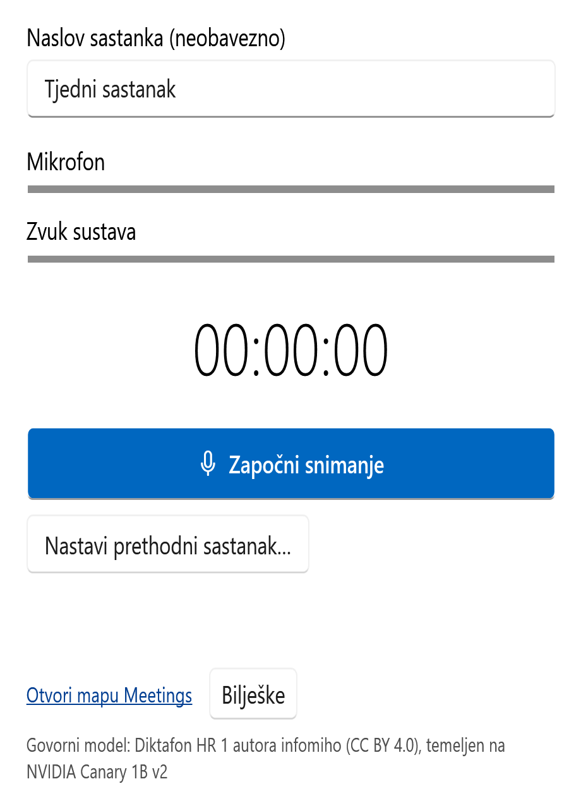

# Meeting Recorder for Windows

[Hrvatski](README.md) · [Download latest Windows release](https://github.com/schtritoff/meeting-recorder-win/releases/latest/download/MeetingRecorder-win-x64.zip)

A Windows desktop app built with .NET 10 and WPF to record microphone and system audio and transcribe Croatian locally using a CPU-only speech engine.



*Interface preview with an example title; no active recording.*

## Build and run

Requires Windows 10/11 x64; building requires the .NET 10 SDK.

```powershell
dotnet publish src/MeetingRecorder -c Release -o publish
.\publish\MeetingRecorder.exe
```

The self-contained, compressed single-file Release executable is `publish/MeetingRecorder.exe`. No separately installed .NET runtime is needed. Download the release ZIP above, extract it and run `MeetingRecorder.exe`. Keep the included license notices. The executable is unsigned, so Windows SmartScreen may show a warning; check the download source before running it.

On first run, the app extracts native libraries and downloads the Croatian model (836,664,032 bytes, about 837 MB). Internet is needed for that download; transcription then runs locally/offline. Cancel/Retry is available, and recording can begin while the model downloads, but processing waits for it. An interrupted download is retried from the beginning; a completed download is checked for size and SHA-256 before use.

The original icon artwork is in `src/MeetingRecorder/Assets/` (SVG, PNG and ICO).

## Use and limitations

- **OpenCode integration is experimental and disabled by default.** The **Continue in OpenCode** button is hidden and the recorder performs no handoff or integration setup unless `%LOCALAPPDATA%\MeetingRecorder\settings.json` contains `"EnableOpenCodeHandoff": true`. Add that property to the existing JSON object, preserving its other settings, and restart the recorder; omit it or set it to `false` to disable the feature. Missing or invalid settings keep it disabled. This does not remove a previously installed OpenCode plugin or delete existing conversations; removal instructions are below. The flag is in Meeting Recorder's settings, not OpenCode's config.
- The GUI uses Croatian when Windows **Settings → Time & language → Language & region → Country or region** is **Croatia**; otherwise it uses English, including when region detection is unavailable. Display language and regional formats do not control this choice. Restart the app after changing the country. Transcription remains Croatian; paths, filenames, transcript metadata, and logs remain English.
- Check both level meters, optionally enter a title, then **Start recording**. Use **Pause**, **Stop** to process, or **Ctrl+M** for the compact floating strip. Obtain participants' consent and follow your recording policy.
- While recording or paused, the app asks Windows to prevent idle system sleep; the screen may still turn off. The request is released on Stop or exit and does not change Windows power settings. If the request cannot be started, recording does not start and an error is shown. This is not a guarantee: closing the lid or explicitly putting the computer to sleep can override it, and on Modern Standby systems on battery Windows can terminate the request five minutes after the sleep timeout. For recordings that must not be interrupted, keep the lid open and use mains power.
- If both OpenCode config files contain plugin lists, an existing Meeting Recorder entry is recognized without changing either file. Adding a new entry still falls back to manual setup when the lists cannot be merged safely.
- The optional **Notes** toggle expands the main window with a right-hand pane of bullet rows (the floating strip has no notes). The pane opens 400 DIPs wide, taking 120 of them from the window's left edge (all kept on the current monitor's work area); the recording controls keep their normal width, so dragging the window's edge to enlarge it gives every extra DIP to the notes, and hiding the pane restores the previous window width. The pane has a fixed height inside the window: many bullets or one long bullet scroll with the wheel (also over a bullet) or the scrollbar, and a newly added bullet scrolls into view. Before **Start** the pane opens but is not editable; starting creates an empty first bullet. Each bullet is stamped with the recording clock at its first keystroke, and the clock is frozen while paused, so edits made during a pause keep that offset. **Enter** adds a new bullet, **Shift+Enter** adds a line break inside the same bullet (one timestamp, exported as a multiline note), multiline paste splits into separate bullets at the current clock time (the row already started keeps its own timestamp, blank pasted lines are ignored), and empty bullets are omitted from exports. Earlier bullets stay editable until **Stop**, which locks the notes immediately before processing; **Retry** never reopens editing, and a new recording clears the editor. Continuing a series starts fresh session notes and never imports or edits an earlier session's notes. Compact mode is unchanged; returning to the full window restores the pane and text.
- Capture follows the **Windows default microphone and output device**. A device manually selected in Teams that differs from the Windows default is not captured by that track. System capture includes other applications playing through the default output, not just Teams.
- Microphone and system tracks are mixed for one Croatian transcription pass. Mixing does **not** remove room-speaker echo or guarantee duplicate-free text; use a headset where possible. No speaker separation, language picker, or cloud transcription is included.
- Quiet recordings: recognition input is boosted in memory (gain capped at 10, before the silence gate); saved audio is unchanged. This is a level lift, not speech detection: background noise can produce spurious text and very quiet speech can still be skipped. Recognition accuracy is not guaranteed.
- When processing finishes (or fails) while the app window is not in focus, Windows' notification chime plays and the taskbar button flashes until you switch to the app.
- Final files are `Documents\Meetings\yyyy-MM-dd_HHmm[_<title>]\recording-transcript.txt` (plain text, first line is the title; the one transcript for people, tools and AI agents) and `recording.mp3` (or AAC `recording.m4a` fallback). The writer derives the transcript name from the encoded audio's basename plus `-transcript.txt`, so both current audio formats give `recording-transcript.txt`. Timestamped audio filenames are not implemented; a future audio-naming change must also update series discovery and stage cleanup. No `transcript.md` or duplicate `transcript.txt` is written any more; folders recorded earlier keep their `transcript.txt`/`transcript.md` untouched and still work as continuation targets. Other files such as `*-transcript-recovered.txt` are not treated as the transcript. A session with at least one nonempty bullet also gets `<audio basename>-notes.txt` (currently `recording-notes.txt`; the bullets, each with its first-input timestamp, e.g. `[03:12] Note: Confirm delivery date.`) and `combined.txt` (transcript chunks and bullets merged by start offset, labeled `Transcript:`/`Note:`; at equal offsets transcript comes first, then notes in row order). **Open transcript** opens that session's `combined.txt` when it exists (transcript and notes together), otherwise the transcript (`recording-transcript.txt`, or the legacy `transcript.txt`), in Notepad. Sessions without notes have only the transcript and recording; no placeholder files are created. Windows' Documents location is used, including OneDrive redirection; cloud-sync software may therefore upload the output even though transcription is local.
- The app regenerates `combined-all-meetings.txt` in the series root after each completed session, combining the first meeting and completed dated continuations in order. It is an app-owned shareable source, not an AI summary; sharing is a participant action. If updating it fails, Done warns you while the completed session remains saved; the next completed session tries again. Existing legacy `notes.txt` remains readable and untouched. Review the contents for sensitive information before sharing.
- The first session stays flat in its meeting folder. To add another session, choose **Continue previous…** and select a recent meeting, or **Browse…** to find a moved meeting folder. The original title is locked while continuing; choose **Start new meeting** to clear the selection without starting a recording. Each continuation is saved in a dated subfolder (`yyyy-MM-dd_HHmm`, with a suffix if needed), leaving existing files in place. A series is recognised by `recording-transcript.txt` (or the legacy `transcript.txt`/`transcript.md`) in its folder, and its title is the first line of that text file (the front-matter title of a legacy `transcript.md`, which wins over a legacy `transcript.txt`), falling back to the folder name. When finished, **Open transcript** opens that session's `combined.txt` or transcript; **Open folder** opens the series folder.
- If the selected meeting folder has disappeared by processing time, the recording is saved as a new standalone meeting and the app displays a notice. If publishing a prepared continuation fails during the final rename, its output and working audio are retained for **Retry**. A directory beginning with `~` is staging, not a finished session: do not casually delete it. The prefix does not set the Windows Hidden attribute.
- **Continue in OpenCode** (Done panel only) asks OpenCode Desktop to open this meeting's conversation, titled with the series title, for the series folder. The first time it must change OpenCode's global config, a Yes/No dialog asks for confirmation; **No** changes nothing and reports that the plugin was not added. **Yes** adds one local plugin entry: a `file:///` URI of `%LOCALAPPDATA%\MeetingRecorder\opencode\meetingrecorder-handoff` in the `plugins` array of `%USERPROFILE%\.config\opencode\opencode.json` (or `opencode.jsonc`). If both files exist, the entry goes in `opencode.jsonc`, the file OpenCode itself writes when both exist; if `opencode.json` has a `plugins` or `plugin` key, or cannot be parsed, the app refuses and shows manual setup, and `opencode.json` is never edited. The plugin source is embedded in the app; nothing is downloaded for it. To remove the integration, delete that entry from the config file. To turn its GUI part off without removing the entry, use the switch for the plugin in OpenCode Desktop's Settings > Extensions > Plugins; while it is off, Continue in OpenCode shows the manual instructions, and the app never switches it back on. If a handoff cannot be verified, the app restores the config bytes it changed; if that is unsafe, the original is kept under `%LOCALAPPDATA%\MeetingRecorder\opencode-backup`, and a `*.retained` file there can be deleted after you have checked it. The request queue is `%LOCALAPPDATA%\MeetingRecorder\opencode-handoff`. The plugin only opens the conversation: it never sends prompts, never calls a model and does not read meeting content. It relies on OpenCode Desktop's experimental plugin API, which can change between OpenCode releases. Desktop 2.2.5 or later is required; an older Desktop must be updated manually. If OpenCode Desktop is missing, the app downloads its installer from an HTTPS GitHub Releases asset of OpenCode; that download is not checked against a published hash or signature. A cold start can take up to about two minutes, and a first-time setup can take longer while OpenCode is installed. Series folders on UNC/network paths get manual instructions only. Setting `MEETING_RECORDER_HOME` (isolated test mode) disables the handoff. When it fails, the panel gives the manual steps: open OpenCode Desktop, open the series folder shown, and select or start the conversation with the title shown (or by the conversation ID when one was reported). Installation, first-time consent, the cold start, tab opening and removal have not been verified on a real machine.
- Notes are autosaved locally as a versioned `notes.json` snapshot in the current working recording folder (never inside `meeting.json` or the audio): saves are debounced 250 ms with a maximum dirty interval of one second and also flushed when leaving the editor, on Pause/Resume, on Stop and on normal shutdown, including the unfinished current bullet. This bounds, but does not eliminate, loss of the newest unsaved edits after a crash or power loss. A notes save error is shown while recording continues, the in-memory draft is kept and the next flush retries; if Stop cannot safely save or export the notes, the working audio and draft are retained and the failure is reported instead of deleting anything. Recovery reads notes without modifying them: a missing snapshot means no notes, a valid temporary snapshot can recover a failed first save, and a corrupt or unreadable snapshot never hides the recording or its note files — the source is retained, the problem is reported, and the recording is not marked completed until all required outputs can be written. Recovered and stopped notes are view-only in this app.
- Models, extracted native libraries, settings, logs, and working recordings are under `%LOCALAPPDATA%\MeetingRecorder`. The app automatically keeps working recordings if processing fails; use **Retry**, or restart and choose **Process now / Later / Discard**. Discard permanently deletes audio after confirmation. After all required outputs are saved — `recording-transcript.txt` and compressed recording, plus `recording-notes.txt`/`combined.txt` when the session has notes — a durable `completed` marker prevents repeat recovery before working-file cleanup. Cleanup failures are logged and can leave marked folders on disk; a marker-write failure keeps both the working audio and finished output. Missing/corrupt meeting metadata never intentionally hides orphan WAVs.
- Only one instance can use the same application-data root at a time. Relaunching requests activation of the existing window, including restoring its compact strip.
- The published single-file `MeetingRecorder.exe` can install itself when started from a removable or network location: after the single-instance check it shows a one-time localized **Install / Not now** prompt with a **Don't ask again** checkbox. On **Install** it atomically copies itself to `%LOCALAPPDATA%\MeetingRecorder\MeetingRecorder.exe`, always creates a Desktop `Meeting Recorder.lnk` (a conflicting unrelated link is preserved under a numbered name), and starts the local copy with a private handoff that waits, before taking over the single-instance guard, for the source process to exit; only a successful launch closes the source. The installed copy then shows a one-time **Pin to taskbar / Not now** prompt when Windows allows a supported pin request (a matching per-user Start-menu link is created for that); if Windows reports pinning as not allowed (for example on some managed computers), no prompt appears and the Desktop shortcut is the way to start the app. Any copy, shortcut or launch failure is reported and leaves the running copy and any installed files usable. Setting `MEETING_RECORDER_HOME` (even empty) suppresses all install, shortcut and pin activity, and loose development builds (apphost/`dotnet run`) are never offered for install.
- Recovery repairs WAV headers using bytes present on disk. Writes are periodically flushed, but unflushed audio may be lost in a crash; filesystem/hardware power-loss durability is **not guaranteed**. Closing during processing may wait for the current native transcription call before exiting.
- `MEETING_RECORDER_HOME` overrides the application-data root; it does **not** redirect the final Documents output.

## Project status

Published as a small, maintenance-focused project. Bug reports are welcome through [GitHub Issues](https://github.com/schtritoff/meeting-recorder-win/issues). Physical device switching, Teams reconnect, long-duration recording and clean Windows installations have not been fully validated. Recognition accuracy is not guaranteed; review transcripts before relying on them.

## Attribution and licenses

- Model: [infomiho/diktafon-dictate-hr-1](https://huggingface.co/infomiho/diktafon-dictate-hr-1), licensed under [CC BY 4.0](https://creativecommons.org/licenses/by/4.0/), based on NVIDIA Canary 1B v2. The app uses the [GGUF quantization](https://huggingface.co/infomiho/diktafon-dictate-hr-1-GGUF).
- transcribe.cpp and ggml: MIT. Bundled native license notices are in `native/win-x64/licenses/`.
- [NAudio](https://github.com/naudio/NAudio): MIT.
