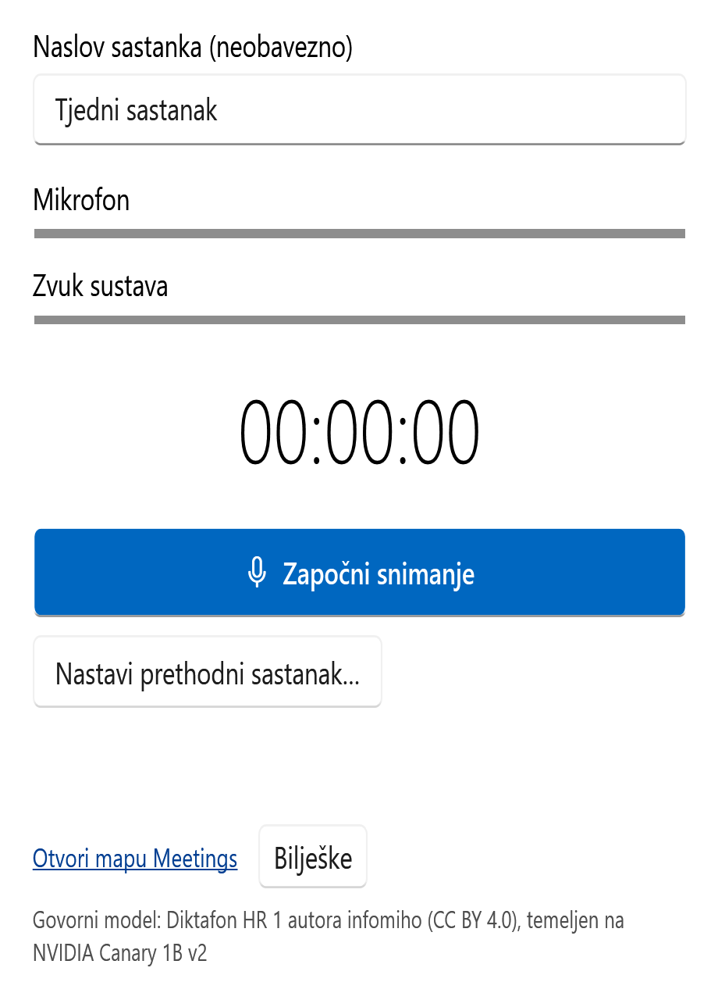

# Meeting Recorder za Windows

Jednostavna aplikacija za snimanje sastanaka i izradu prijepisa na hrvatskom jeziku. Snima mikrofon i zvuk računala, a govor pretvara u tekst **lokalno, bez slanja snimke u oblak**.

*Prikaz sučelja s primjerom naslova, bez aktivnog snimanja.*

## Preuzimanje

### [⬇ Preuzmi najnoviju verziju za Windows](https://github.com/schtritoff/meeting-recorder-win/releases/latest/download/MeetingRecorder-win-x64.zip)

Za **Windows 10 i 11, 64-bitni**. Nije potrebno zasebno instalirati .NET.

1. Preuzmite ZIP i raspakirajte ga.
2. Pokrenite **MeetingRecorder.exe**.
3. Pri prvom pokretanju aplikacija preuzima govorni model (oko **837 MB**). Nakon preuzimanja prijepis radi i bez interneta.
4. Provjerite pokazivače mikrofona i zvuka sustava pa odaberite **Započni snimanje**. Nakon zaustavljanja pričekajte izradu prijepisa.

Aplikacija nije digitalno potpisana pa Windows SmartScreen može prikazati upozorenje. Prije pokretanja provjerite da ste je preuzeli iz ovog repozitorija.

## Što može?

- Snimanje mikrofona i zvuka računala, primjerice tijekom Teams sastanka.
- Automatski prijepis hrvatskog govora, bez pretplate i API ključeva.
- Bilješke s vremenskim oznakama tijekom snimanja.
- Pauziranje, mali plutajući prozor (**Ctrl+M**) i nastavak prethodnog sastanka.
- Spremanje zvuka, prijepisa i bilježaka u mapu **Dokumenti → Meetings**.

Sučelje je na hrvatskom ako je država ili regija u postavkama Windowsa postavljena na Hrvatsku; inače je na engleskom.

## Dobro je znati

- Prije snimanja pribavite pristanak sudionika.
- Koriste se zadani Windows uređaji. Ako Teams koristi druge uređaje, njihov zvuk možda neće biti snimljen. Preporučuju se slušalice.
- Prijepis nije nepogrešiv i ne razlikuje govornike. Prije dijeljenja pregledajte tekst i osjetljive podatke.
- Obrada radi na procesoru i može potrajati. Za duže snimanje ostavite računalo priključeno na napajanje, s otvorenim poklopcem.
- Snimke ostaju lokalno, ali ih OneDrive ili drugi program za sinkronizaciju može prenijeti ako sinkronizira Dokumente.
- OpenCode integracija je eksperimentalna i zadano isključena.

Ovo je mali projekt za praktičnu upotrebu i demonstraciju, s naglaskom na održavanju i ispravcima grešaka. Nisu iscrpno provjereni svi uređaji, višesatna snimanja i ponovno povezivanje poziva.

[Upute na engleskom i izgradnja iz izvornog koda](README.en.md) · [Prijava greške](https://github.com/schtritoff/meeting-recorder-win/issues)

## Licenca i zahvale

MIT licenca; pogledajte [LICENSE](LICENSE) i [THIRD-PARTY-NOTICES.md](THIRD-PARTY-NOTICES.md).

Hrvatski prijepis omogućuju model [Diktafon](https://huggingface.co/infomiho/diktafon-dictate-hr-1) autora infomiho (**CC BY 4.0**), temeljen na NVIDIA Canary 1B v2, te transcribe.cpp i ggml. Zvuk se snima pomoću NAudio.
